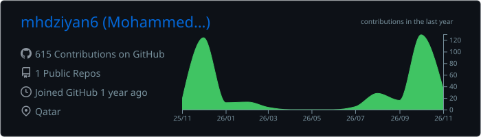
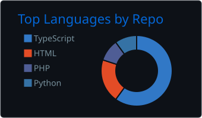
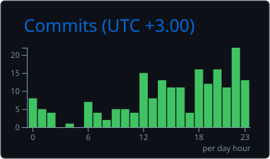

<p align="center">
  
</p>

## 🎯 About Me

```js
const ziyan = {
  role: "Full-Stack Developer",
  location: "Qatar 🇶🇦",

  building: [
    "SecureThread — vulnerability management + AI triage",
    "Careerist — AI career guide for students & graduates",
  ],

  shipped: ["CV table-occupancy monitor", "Document AI", "CRM", "Routine tracker"],

  stack: {
    frontend: ["React", "TypeScript", "Vite", "Tailwind", "shadcn/ui"],
    backend:  ["FastAPI", "Node.js", "Supabase", "PostgreSQL"],
    ai:       ["Groq", "OpenAI", "YOLO", "OpenCV", "PyTorch"],
  },

  currently: "building my portfolio",
};
```

## 🤝 Connect With Me

<p align="center">
  <a href="https://www.linkedin.com/in/mohammedziyan7/"></a>
  <a href="https://x.com/ziyaaaannn"></a>
  
</p>

## 🔭 Featured Work

<table>
  <tr>
    <td width="50%" valign="top">
      <h3><a href="https://github.com/SthIntern01/SecureThread">🛡️ SecureThread</a></h3>
      Vulnerability management platform. Scans repos across GitHub, GitLab and Bitbucket, triages findings with AI and cuts false positives, then reports to Slack as PDFs.
      <br/><br/>
      
      
      
      
    </td>
    <td width="50%" valign="top">
      <h3><a href="https://github.com/career-wise/Careerist">🧭 Careerist</a></h3>
      AI career guide for students and graduates. Chat, mock interviews and goals share one event log, so the assistant reacts to what you did elsewhere in the app.
      <br/><br/>
      
      
      
      
    </td>
  </tr>
</table>

## 🛠️ Tech Stack

<p align="center">
  <br/>
  
</p>

<p align="center">
  
  
  
  
  
  
  
  
</p>

## 📊 GitHub Analytics

<!-- Cards below are generated daily by .github/workflows/profile.yml -->
<p align="center">
  
</p>
<p align="center">
  
  
</p>

## 🧱 Contribution Calendar

<p align="center">
  
</p>


